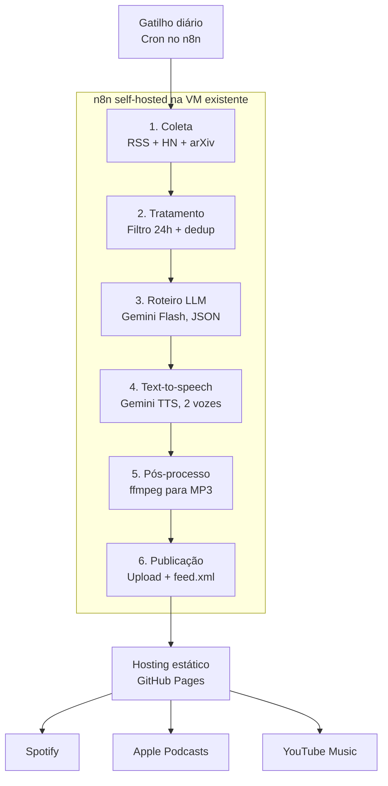
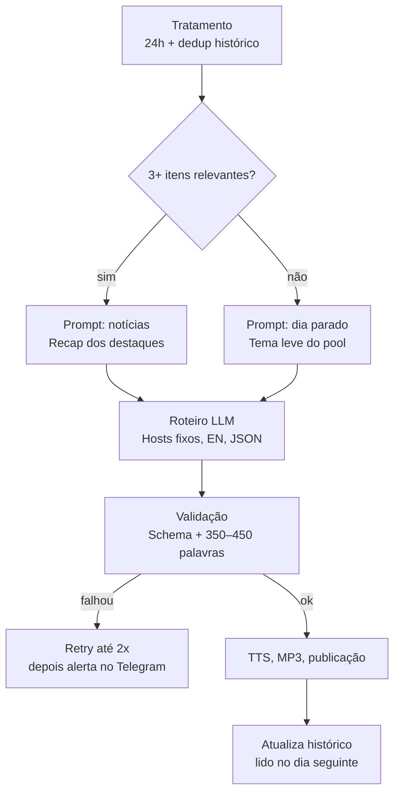

# Podcast automatizado de AI Engineering: arquitetura e requisitos

> Fase: discovery (sem implementação). Última atualização: 2026-10-22.

## 1. Objetivo

Gerar e publicar todos os dias, sem intervenção humana, um episódio curto em áudio, no estilo podcast, com dois hosts conversando sobre as novidades de **AI Engineering** das **últimas 24 horas**.

Princípios:

- **KISS**: um único workflow, sem banco de dados e sem fila. Neste momento, qualidade de áudio e complexidade da conversa não são prioridade.
- **Custo mínimo**: usar free tier sempre que possível. A meta é R$ 0/mês.
- **100% automático**: coleta, roteiro, áudio e publicação sem aprovação humana.

## 2. Decisões tomadas

| Tema | Decisão |
|---|---|
| Idioma | Inglês (EN) |
| Duração | 2 a 3 minutos (~350–450 palavras) |
| Hosts | Nome e persona fixos: um homem e uma mulher, levemente humorados e educados |
| Aprovação | Nenhuma. Processo 100% automático, protegido por guardrails |
| Dia sem notícias | Gerar uma conversa bem-humorada sobre um tema leve de AI Engineering |
| Orquestração | n8n self-hosted, na VM que já está rodando |
| Domínio próprio | Ainda não decidido. Começar sem domínio (ver seção 7) |

## 3. Arquitetura geral

As plataformas **leem o feed RSS**. O feed é cadastrado manualmente uma única vez em cada uma; a partir daí, cada episódio novo publicado no feed aparece sozinho.

## 4. Fluxo detalhado (v2, com os requisitos aplicados)

## 5. Stack por etapa

| Etapa | Ferramenta (free tier) | Observações |
|---|---|---|
| Orquestração | n8n self-hosted (Docker) na VM existente | Precisa de ffmpeg na imagem e do nó Execute Command habilitado |
| 1. Coleta | Nó RSS Read do n8n: hnrss.org (filtro "LLM OR agent"), arXiv cs.CL/cs.AI, blogs (Simon Willison, Hugging Face, Anthropic, OpenAI, LangChain), r/LocalLLaMA `.rss` | Sem API key e sem custo. Opcional: Tavily (~1.000 buscas/mês grátis) |
| 2. Tratamento | Nó Code (JS): filtra `pubDate >= now-24h`, deduplica por URL/título e contra o histórico, remove HTML, corta cada item em ~500 caracteres e fica com o top ~8 | Determinístico, sem custo |
| 3. Roteiro | Gemini Flash (free tier). Alternativa: Groq (Llama, free tier). Uma chamada que devolve JSON `[{speaker: "A", text: "..."}]` | Uma chamada por dia cabe com folga no limite gratuito |
| 4. TTS | Gemini TTS multi-speaker: os 2 hosts numa única chamada | Fallback: Google Cloud TTS (~1M caracteres/mês grátis nas vozes neurais, contra ~75k caracteres/mês de uso) ou Kokoro/Piper local |
| 5. Pós-processo | ffmpeg: PCM/WAV para MP3 64–96 kbps mono. `ffprobe` para conferir a duração | Apple e Spotify esperam MP3/M4A via RSS |
| 6. Publicação | Commit do MP3 + `feed.xml` (RSS 2.0 com tags iTunes) num repositório do GitHub Pages | Nenhuma plataforma grande oferece API gratuita de upload de podcast; RSS próprio é o caminho automatizável |
| Observabilidade | Error Trigger do n8n mandando alerta no Telegram | Grátis |

**Custo estimado:** R$ 0/mês dentro dos free tiers. Gasto opcional: domínio (~US$ 10/ano).

## 6. Requisitos funcionais

### 6.1 Hosts e roteiro

- As personas ficam fixas no system prompt: nome, papel e um traço de humor para cada host (por exemplo, ele mais curioso, ela mais pragmática e irônica de leve).
- Abertura e encerramento fixos, para dar identidade ao programa.
- Regras do prompt:
  - Não inventar fatos; falar só do que está nos itens coletados.
  - Citar a fonte pelo nome ("according to Hugging Face's blog…").
  - Humor leve e educado; nada ofensivo.
  - Falas alternadas entre A e B, total de 350–450 palavras.
- Saída em JSON estruturado, para validação automática.
- Vozes no Gemini TTS: um par masculino/feminino das vozes pré-definidas (por exemplo, Puck e Aoede). Ouvir algumas antes de fixar.

### 6.2 Dia sem notícias

- Um IF conta os itens relevantes após o tratamento. Abaixo de 3, o fluxo usa o prompt de "slow news day".
- Pool fixo de ~30 temas leves e atemporais de AI Engineering (custo de tokens, evals, prompt vs. fine-tune, etc.).
- O histórico registra o tema usado, para não repeti-lo em menos de 30 dias.

### 6.3 Guardrails (substituem a aprovação humana)

- O roteiro precisa seguir o schema JSON e ter entre 350 e 450 palavras. Se não passar, novo pedido ao LLM, até 2 vezes.
- Antes de publicar, `ffprobe` confere se o MP3 tem entre 1,5 e 4 minutos.
- Se o TTS principal falhar, usar o TTS de fallback.
- Se tudo falhar, o episódio do dia **não é publicado** e chega um alerta no Telegram. Nunca publicar um episódio quebrado.
- Dedup histórico: guardar as URLs já cobertas, para não repetir a mesma notícia em dias seguidos.

### 6.4 Histórico (estado entre execuções)

- Guarda as URLs cobertas e os temas usados em dias sem notícias.
- Armazenamento: static data do workflow no n8n ou um JSON no próprio repositório do GitHub Pages. Não precisa de banco.

## 7. Hospedagem e domínio

- **Começar sem domínio próprio**, no GitHub Pages: `https://<usuario>.github.io/<repo>/feed.xml`.
- Se depois for configurado um domínio próprio no GitHub Pages, o GitHub redireciona a URL antiga com 301, e Spotify e Apple seguem esse redirecionamento. Por isso a decisão do domínio pode esperar.
- **A URL do feed precisa estar definida antes do primeiro cadastro** no Spotify e na Apple.
- Retenção: apagar episódios com mais de ~90 dias (~1,4 MB por episódio a 64 kbps), para respeitar o limite de ~1 GB do GitHub Pages.
- Evitar o Cloudflare R2 sem domínio próprio: a URL pública `r2.dev` tem limite de requisições e não serve para produção.

## 8. Checklist da VM com n8n

- [ ] Imagem Docker do n8n com `ffmpeg` e `ffprobe`.
- [ ] Nó Execute Command habilitado (no n8n 2.x ele vem desligado por padrão).
- [ ] `GENERIC_TIMEZONE` configurado, para o cron e a janela de 24h ficarem no fuso certo.
- [ ] Credenciais no n8n: chave da API Gemini, token do GitHub (fine-grained, escrita em um único repositório) e bot do Telegram.
- [ ] A VM só faz chamadas de saída; não precisa expor nada publicamente.

## 9. Pontos de atenção

1. **O Google Podcasts não existe mais.** Foi encerrado em 2024 e migrou para o YouTube Music.
2. **Não existe API pública de upload no Spotify.** O caminho é o RSS próprio. O Spotify faz polling do feed, então o episódio pode levar algumas horas para aparecer.
3. **YouTube via Data API** (alternativa ao RSS) exige gerar um MP4 (imagem estática + áudio), e projetos de API não verificados sobem os vídeos como privados até passarem por auditoria. Preferir o RSS.
4. **Os limites do free tier mudam com frequência.** Validar as cotas atuais do Gemini TTS, que ainda está em preview e tem limites baixos, antes de fechar a stack. No free tier do Gemini, os dados podem ser usados para treinar os modelos.
5. **Conteúdo e compliance:** o roteiro deve resumir as notícias, não reproduzi-las, e citar as fontes nas show notes. Spotify e YouTube pedem que conteúdo sintético seja sinalizado como gerado por IA.

## 10. Pendências

- [x] Nomes dos hosts: Lucas e Sarah.
- [x] Nome do podcast: Pod.AI.
- [ ] Arte de capa: quadrada, entre 1400 e 3000 px (exigida por Apple e Spotify).
- [x] E-mail do dono do feed (`itunes:owner`): Flávio Tomé, flaviotome5@gmail.com. O Spotify manda um código para esse e-mail na verificação.
- [ ] Horário de publicação e fuso de referência da janela de 24h.
- [ ] Categoria do podcast (sugestão: Technology) e `explicit = false`.
- [ ] Domínio próprio: sim ou não (não bloqueia o início).
